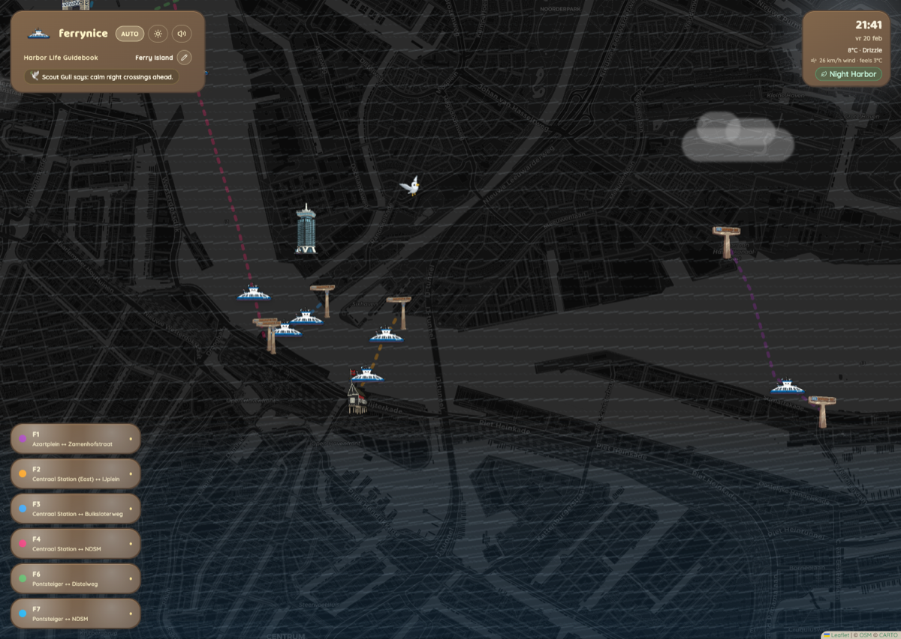

# Amsterdam Ferry Finder

Fun side project to explore Amsterdam ferries on an interactive map with route and departure details.

Live: https://ferry.bramrolvink.nl



## Stack

- React + TypeScript + Vite
- Tailwind CSS + shadcn/ui
- Leaflet (map)

## Run locally

```sh
npm install
npm run dev
```

## Production build

```sh
npm run build
npm run preview
```

## Ferry schedule updates

Schedule data lives in `src/data/ferryScheduleData.ts` (generated; about 26 KB). It holds GVB's real departure times for every route, from both docks, per weekday. Times are minutes since the service day's midnight in Amsterdam time. Values of 1440 or more are after-midnight sailings that belong to the previous service day. Identical days are stored once. `src/data/ferries.ts` reads it and does all time logic in Europe/Amsterdam, whatever the visitor's timezone.

To refresh from GVB:

```sh
npx playwright install chromium   # once
npm run update:ferry-schedules
```

If the Playwright-managed browser can't be installed, point the updater at any Chromium binary with `PLAYWRIGHT_CHROMIUM_EXECUTABLE=/path/to/chrome`.

The updater opens `https://gvb.nl/en/travel-information/stops-and-timetable` in headless Chromium and calls GVB's timetable APIs from that page. It fetches a three-week window and, for each weekday, keeps the pattern that occurs most often, so one holiday in the window doesn't replace a normal day. Public holidays themselves are not modelled.

- Requests are retried. After a 403, the updater reloads the page before retrying.
- If a route fails or returns implausible data, that route keeps its existing data.
- If every route fails, the script writes nothing and exits non-zero.
- `meta.lastChecked` is updated on every successful run. `meta.lastUpdated` changes only when the timetable content changes.

GitHub Actions workflow: `.github/workflows/ferry-schedule-refresh.yml` (Mondays 04:00 UTC, plus manual dispatch). Because `lastChecked` changes, every successful run commits. That keeps the repository active, so GitHub won't disable the schedule for inactivity. If it was disabled anyway, re-enable it under Actions → Refresh Ferry Schedule.

## Docker

This repo includes a production-ready `Dockerfile` + `nginx.conf` for serving the built SPA.
